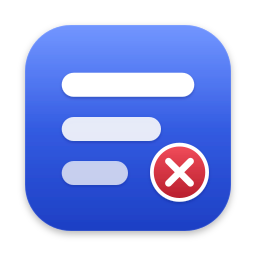
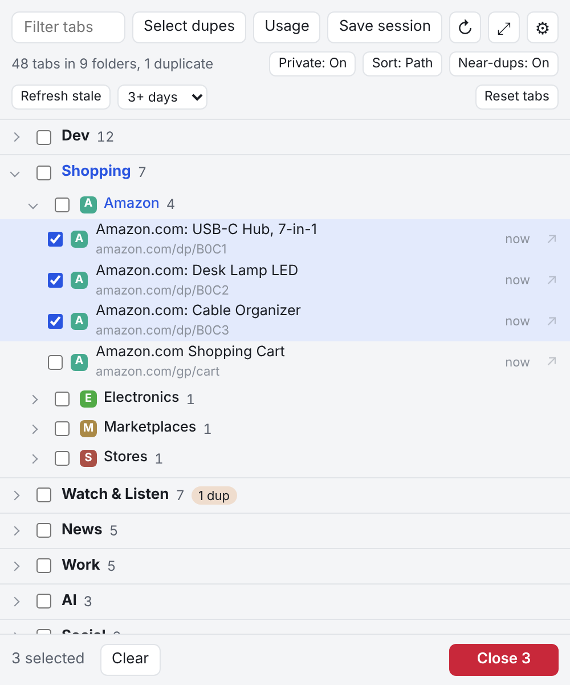
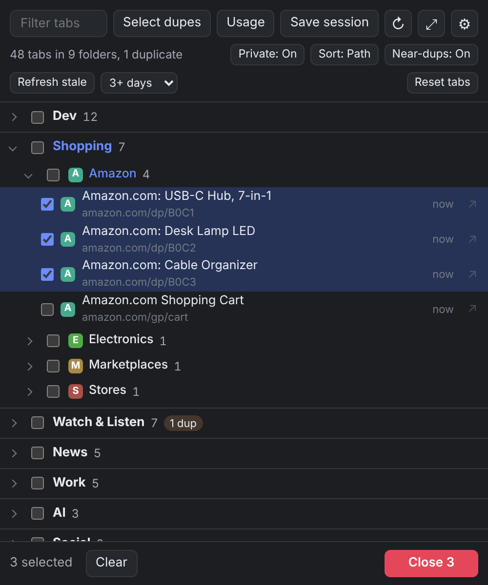
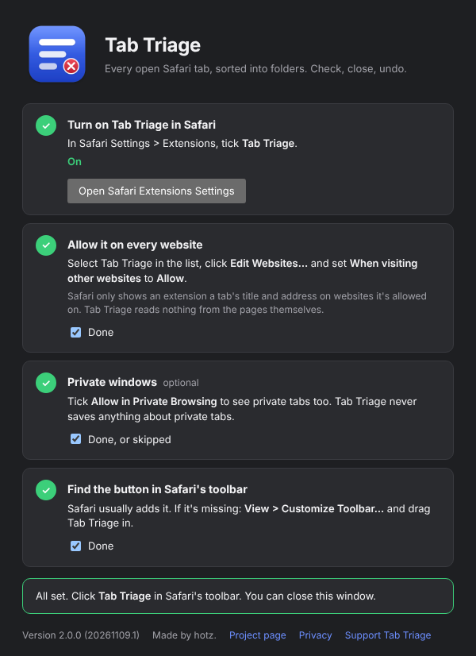

  

<h1 align="center">Tab Triage</h1>

  Every open Safari tab, sorted into folders. Check, close in one action, undo for a minute. 
  Free. Runs entirely on your Mac.

  <a href="#install">Install</a> ·
  <a href="docs/HOW_TO_USE.md">How to use</a> ·
  <a href="PRIVACY.md">Privacy</a> ·
  <a href="https://github.com/sponsors/jhotzfoto">Support</a>

  
  

## What it does

- **Sorts every tab** in every Safari window into folders and groups: Shopping ▸ Amazon ▸ your Amazon tabs. Comes with starter folders; organize your own by drag and drop.
- **Closes in bulk.** Tick tabs, a whole group or a whole folder, close them in one go. It always asks first, and **Undo** brings them back for a minute.
- **Finds duplicates.** **Select dupes** picks every blank tab and every extra copy of the same page.
- **Saves sessions.** One click saves every open tab, window by window. Restore all of it, one window, or one page later.
- **Frees memory.** **Refresh stale** reloads tabs you haven't looked at in days (long-open tabs keep growing; reloading shrinks them). **Reset tabs** gives every tab a fresh start without quitting Safari.
- **Shows usage.** Safari's memory and CPU, and what a close or reload freed.
- **Private by design.** Nothing leaves your Mac. Private tabs are never saved anywhere, not even for Undo. Pinned tabs can't be closed by accident.

## Requirements

- macOS 11 Big Sur or later, Apple Silicon or Intel
- Safari 15.4 or later

Tested on macOS 15 Sequoia with Safari 26.

## Install

Tab Triage isn't on the App Store, so there are two ways to install it.

### Option A: build it yourself (recommended)

Builds a copy signed with your own Apple ID, so Safari keeps it turned on like any other extension. About 10 minutes the first time, mostly the Xcode download.

1. **Get Xcode** (free) from the [Mac App Store](https://apps.apple.com/app/xcode/id497799835). Open it once and let it finish setting up.
2. **Add your Apple ID to Xcode:** Xcode > Settings > Accounts > **+** > Apple ID. A free Apple ID is enough. Then select your team ("Personal Team"), click **Manage Certificates**, click **+** and choose **Apple Development**.
3. **Download Tab Triage:** the green **Code** button above > **Download ZIP**, then double-click the zip to unpack it.
4. **Build it:** open **Terminal**, type `bash ` (with a space after it), drag `Build_and_Install.command` from the unpacked folder into the Terminal window and press Return. It builds Tab Triage, puts it in the Applications folder in your home folder and opens it.
5. **Follow the setup window.** It walks you through turning Tab Triage on in Safari and shows a tick when it's on.

If something goes wrong, the script says what to do in plain English.

### Option B: download the prebuilt app (quick try)

Not signed, because signing for download needs a paid Apple developer account. Safari turns unsigned extensions off **every time it quits**, so you'll repeat step 4 after each restart. Use Option A to keep it.

1. Download `Tab-Triage-<version>.zip` from [Releases](https://github.com/jhotzfoto/tab-triage/releases) and double-click it.
2. Move **Tab Triage.app** into your Applications folder and open it. macOS will say it can't check it for malicious software.
3. Open **System Settings > Privacy & Security**, scroll down and click **Open Anyway** next to Tab Triage, then confirm with your password.
4. In Safari: **Settings > Advanced** > tick **Show features for web developers**. Then in the menu bar: **Develop > Allow Unsigned Extensions**.
5. Follow the Tab Triage setup window.

## Using it

Click **Tab Triage** in Safari's toolbar. Folders start collapsed; click one to open it, tick what you want gone, press **Close**. The full guide, with every shortcut: [How to use](docs/HOW_TO_USE.md).

## Questions

**Why does it ask for access to all websites?**
Safari only tells an extension a tab's title and address on websites it's allowed on. Without that, Tab Triage couldn't sort anything. It never reads what's on the pages: it has no content scripts.

**Does it send my data anywhere?**
No. No servers, no analytics, no accounts. See [Privacy](PRIVACY.md).

**Why isn't it on the App Store?**
Apple charges developers a yearly fee to sign apps for the App Store or for download. Building it yourself (Option A) gets the same result for free.

**How do I update?**
Download the new version and run `Build_and_Install.command` again. Your folders, settings and sessions are kept in Safari, so they stay.

**How do I uninstall?**
Safari > Settings > Extensions > untick Tab Triage, then drag Tab Triage.app from Applications to the Trash. This also removes your folders, settings and sessions.

## Support

Tab Triage is free. If it saves you time, you can [support it on GitHub Sponsors](https://github.com/sponsors/jhotzfoto).

Bugs and ideas: [open an issue](https://github.com/jhotzfoto/tab-triage/issues).

## For developers

| Path | What it is |
|---|---|
| `extension/` | The Safari web extension (Manifest V3, plain JavaScript, no dependencies, no build step). `lib/grouping.js` holds the pure logic. |
| `native/` | The app's Swift side: the Usage handler and the guided-setup window. |
| `tests/run.js` | Unit and end-to-end tests against a mocked Safari API (`Run_Tests.command`, needs Node). |
| `Build_and_Install.command` | Generates the Xcode project with Apple's packager, builds a universal app and installs it. |

Every push runs the tests; every `v*` tag builds the prebuilt app and attaches it to a release.

## License

Free to use, source available, **not open source**: you may build and use Tab Triage, but not redistribute it or reuse its code. See [LICENSE](LICENSE.md).

© 2026 hotz.
